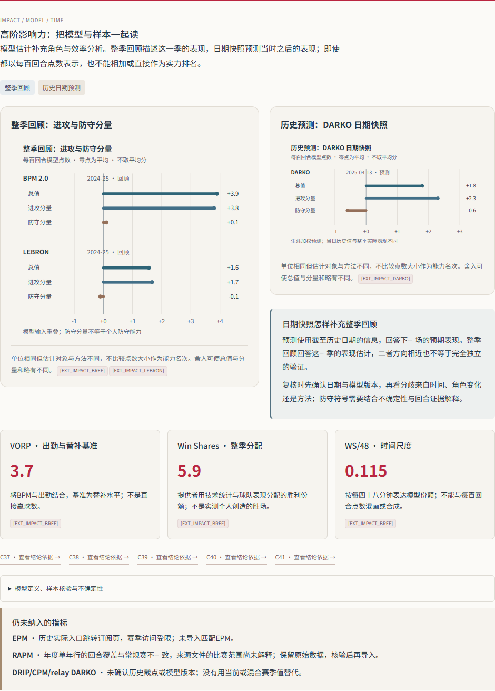

# NBA Player Analyst

**基于可追溯数据的 NBA 球员研究 Skill：从统计证据到中文分析、交互式研究册与结论长图。**

A Codex skill for evidence-based NBA player analysis, Chinese reports, interactive HTML research books, and team-themed visual summaries. Missing data stays explicit; unsupported ratings are never invented.

**当前版本：v0.8.1** · 单球员 / 单赛季 · 常规赛或季后赛 · 中文输出

[下载完整包](https://github.com/hank14363-hub/nba-player-analyst/releases/download/v0.8.1/nba-player-analyst-v0.8.1.zip) · [Release 说明](https://github.com/hank14363-hub/nba-player-analyst/releases/tag/v0.8.1) · [Skill 主流程](SKILL.md) · [开发路线](references/development_roadmap.md)

## 项目能做什么

围绕球员的竞争特点、使用条件和战术适配，将数据、判断与来源放在同一份可阅读、可复算的成果中。适合球员研究、球探报告和赛季复盘；不用于即时比分或投注建议。

| 研究能力 | 具体成果与条件 |
| --- | --- |
| 数据采集与导入 | 采集 NBA Stats 数据，或导入已核验的 JSON/CSV；保存原始表、采集时间与来源，并支持失败表的单独补抓 |
| 进攻与组织分析 | 结合基础、进阶、受助攻及追踪指标，解释产量、效率、创造机会和失误成本；披露各表覆盖范围 |
| 描述性 On/Off | 仅在同队 On、Off 数据及分钟范围一致时比较；球队在场表现不等于个人因果贡献 |
| 真实投篮交互 | 核验出手与命中总数后绘制点位、区域及出手频次热区；支持筛选、逐次点亮、暂停调速和正文往返 |
| 同角色比较 | 使用完整且经过核验的联盟样本，展示实际值、同组中位数、统计百分位与门槛敏感性；不生成综合能力评级 |
| 高阶影响力补充 | 支持 BPM、VORP、Win Shares、公开 LEBRON 转引与带日期的 DARKO 历史预测，分别披露模型、样本和来源链 |
| 图文表达 | 输出中文长文、球队主题色的离线 HTML 研究册和结论长图；四项封面指标根据球员特点及已登记证据选择 |
| 文章与录像研究 | 对实际查阅的球评文章署名引用；支持真实录像观察记录，保留比赛、时间码、观察者及替代解释 |

图表和结论取决于数据是否齐全。缺失项明确保留，不以模板、合成样本或其他赛季读数代替。

## 先选对下载方式

| 内容 | GitHub 仓库源码 | Release 完整包 |
| --- | --- | --- |
| `SKILL.md`、脚本、参考文档、视觉资源、代理配置 | 有 | 有 |
| 最新及历史完整案例 `examples/` | 无 | 有 |
| 测试与夹具 `tests/` | 无 | 有 |
| 验证说明与历史资料 `documentation/` | 无 | 有 |
| 打包清单、更新记录与文件摘要 | 无 | 有 |

**首次使用、浏览案例或运行完整回归，建议下载 Release 附件 `nba-player-analyst-v0.8.1.zip`，约 94.9 MiB。** GitHub 自动生成的 **Source code (zip)** 是仓库源码快照，不包含完整案例、测试和历史文档。

只需要核心 Skill 时，可以使用仓库源码。两种方式均保留数据核验与呈现流程；大体积案例通过 Release 分发。

## 安装与快速开始

### 1. 放入 Codex 的 Skills 目录

下载并解压完整包，将其中的 `nba-player-analyst/` 文件夹放入 Skills 目录，保证 `SKILL.md` 位于该文件夹的第一层。

按当前 [OpenAI 官方 Skills 文档](https://developers.openai.com/codex/skills/)，可选择：

- **个人使用：** `~/.agents/skills/nba-player-analyst/`；Windows 对应 `%USERPROFILE%\.agents\skills\nba-player-analyst\`。
- **项目使用：** `<项目根目录>/.agents/skills/nba-player-analyst/`。

已有环境若已识别该 Skill，可继续使用现有安装位置，避免重复安装同名 Skill。Codex 会自动发现技能变化；如果没有出现，重启 Codex 后再检查。

### 2. 准备运行环境

使用 **Python 3.10+**。在解压后的 `nba-player-analyst/` 目录运行以下命令，建议将依赖装入项目虚拟环境：

```bash
python -m pip install -r requirements.txt
```

离线指标复算及 HTML/SVG 渲染使用 Python 标准库；在线采集需要 `nba_api`，公开第三方影响力采集还需要 `requests` 和 `beautifulsoup4`。完整测试中的部分解析检查也依赖这些包。

PNG/PDF 导出可选安装：

```bash
python -m pip install -r requirements-print.txt
```

导出还需要兼容的 Chromium，可使用已安装的 Chrome/Edge，或另行运行 `python -m playwright install chromium`。**阅读已生成的单文件 HTML 不需要 Python、浏览器服务或上述依赖。**

### 3. 在 Codex 中调用

```text
使用 $nba-player-analyst 分析凯德·坎宁安（Cade Cunningham，NBA ID 1630595）
2024-25 赛季常规赛的表现，重点研究持球创造、投篮效率、失误成本和战术适配。

优先使用可追溯的官方数据，并补充能核验的公开高阶影响力数据。
根据他的竞争特点选择四项封面核心指标；有完整样本时再做同角色比较。
生成中文图文长文、交互式 HTML 研究册、结论长图及来源清单。
对缺失、转引、模型预测和分析推断分别标注，不生成未经校准的综合分或能力排名。
将成果写入新的输出目录。
```

换球员时明确姓名或 NBA ID、赛季和比赛类型；可补充实际球队范围、拟适配球队或研究问题。旧案例用于展示流程，不能代替新球员、新赛季的取数与分析。

## 最新案例：坎宁安 2024–25 常规赛

以下路径均位于 **Release 完整包解压后的 `nba-player-analyst/` 目录**，不是当前仓库内的在线展示页。

打开：

```text
examples/cade-cunningham-2024-25-official-v081/research_book.html
```

研究册包含个性化四项封面、图文主题分析、真实投篮交互、同角色比较、高阶影响力模块，以及可跳转和检索的来源索引。单文件可直接在浏览器中离线打开。



*真实案例截图：BPM、LEBRON 与 DARKO 分别解释，防守分量与个人防守能力保持区分。*

| 案例文件 | 用途 |
| --- | --- |
| `research_book.html` | 阅读交互式图文研究册 |
| `report.md` + `charts/` | 阅读或编辑带图正文；复制时保留图表目录 |
| `player_poster.html` / `player_poster.png` | 浏览与分享结论长图 |
| `data_bundle.json`、`raw/` | 查看可复算输入与原始数据快照 |
| `analysis.json`、`metrics.csv` | 查看计算结果和指标状态 |
| `claims.json`、`sources.json` | 核对结论、数值与引用关系 |
| `impact_access_audit.json` | 查看高阶数据访问情况与排除原因 |
| `release_validation.json` | 查看本轮验证范围 |

该案例保留 **70 场、1,457 次真实出手**；出手总数与基础表核对一致。v0.8.1 包含 **141 个可用指标、41 条登记结论及 15 张 SVG 分析图**。这些数量仅描述此案例，其他球员的数据覆盖和图表数量可能不同。

此前案例与样式保留在完整包的 `examples/` 和 `documentation/history/` 中；建议先看 v0.8.1，再按需要查阅历史版本。`examples/demo_output/` 是合成样式测试，不是真实球员研究。

## 高阶数据：已接入与仍缺失的部分

| 数据家族 | v0.8.1 的使用方式 | 解释边界 |
| --- | --- | --- |
| BPM / OBPM / DBPM、VORP、WS 系列 | 采集 Basketball Reference 的公开整季表 | 属于模型估计；胜利份额不等于个人因果贡献，防守分量不等于个人防守能力 |
| LEBRON | 使用 BBall Index 经 nbarapm 的公开转引，并显示来源链 | 不是原站历史导出；来源缺失的场次、方法访问限制与分钟差异如实披露 |
| DARKO DPM | 使用官方可见、带日期的历史预测行；案例日期为 `2025-04-13` | 生涯加权的预测，不是整季实际表现；不以当前值回填历史，不声称复现当年模型版本 |
| 历史实际 EPM | 尚未导入；案例访问跳转订阅入口 | 保留缺失与访问记录，不以其他日期的预测代替 |
| RAPM | 已保留候选及排除原因，未纳入案例模型图 | 比赛集合与回合覆盖仍待核验，年份相同不足以证明范围一致 |

不同模型的输入可能重叠，方向相近不能视为独立实验。**不相加、平均或任意加权生成综合实力分；不把模型防守分量改名为个人防守评分。**

统计百分位描述球员在特定同组样本中的位置，不是能力百分位。投篮热区表示真实出手频次；没有可靠坐标和完整事件核验时，不画真实位置热区。

## 可选：命令行工作流

以下命令均在 Skill 根目录运行，输出路径使用新的或空的目录。实际取数仍取决于接口访问及数据可用性。

### 官方采集与故障诊断

```bash
python scripts/run_analysis.py --player-id 1630595 --season 2024-25 --tracking --shots --on-off-team-id 1610612765 --out runs/cade-online
```

`--on-off-team-id` 必须对应球员实际研究样本球队，不能填写假设适配球队。若出现接口故障，可先保存诊断：

```bash
python scripts/diagnose_network.py --season 2024-25 --out runs/network-check/network_diagnostic.json
```

诊断成功不保证所有接口或以后每次访问成功；取数失败时输出缺失与补数清单。

### 离线复算完整包内的案例

```bash
python scripts/run_analysis.py --input examples/cade-cunningham-2024-25-official-v081/data_bundle.json --player-id 1630595 --season 2024-25 --comparisons --out runs/cade-offline
```

`--input` 不联网，不能与 `--tracking`、`--shots`、`--on-off-team-id` 同用。`--comparisons` 只在保留且核验通过的完整联盟表上计算，不会自动补造比较样本。

### 可选高阶影响力补数

```bash
python scripts/collect_impact.py --bundle runs/cade-online/data_bundle.json --player-id 1630595 --name "Cade Cunningham" --bref-key cunnica01 --providers BREF LEBRON DARKO --cutoff 2025-04-13 --out runs/cade-impact
python scripts/run_analysis.py --input runs/cade-impact/data_bundle.json --player-id 1630595 --season 2024-25 --comparisons --out runs/cade-impact-analysis
```

此采集器当前仅支持完整常规赛，须核验提供者球员键和历史日期；拒绝、限流、超时或结构异常时记录并停止相应来源。EPM 与范围未核验的 RAPM 不属于已接入的自动采集结果。

**`run_analysis.py` 只生成证据包（`evidence_ready`），不会自动完成成稿。** Codex 还需据此完成 `report.md`、`claims.json`、`book_content.json` 和 `poster_content.json`，核对引用与文字，再渲染成果。

### 完成内容后的渲染与检查

```bash
python scripts/review_language.py --run-dir runs/cade-impact-analysis
python scripts/validate_report.py --run-dir runs/cade-impact-analysis
python scripts/render_research_book.py --run-dir runs/cade-impact-analysis --theme auto
python scripts/validate_book.py --run-dir runs/cade-impact-analysis
python scripts/render_player_poster.py --run-dir runs/cade-impact-analysis --theme auto
python scripts/validate_poster.py --run-dir runs/cade-impact-analysis
```

PNG 导出使用 `scripts/export_poster.py`；可通过 `--browser-path` 指定已安装的 Chrome/Edge。PDF 按需要另行导出并检查分页。重建已有派生文件时按相应脚本说明使用 `--force`，保留原始数据。

## 验证与方法文档

v0.8.1 发布时 **285 项单元回归通过**，并完成本轮影响力与来源模块在 1440 / 1024 / 768 / 390 宽度下的呈现检查，以及无 JavaScript 和打印检查。完整说明位于 Release 包的 `documentation/validation_v081.md`；案例中的部分投篮交互检查记录沿用此前版本，本轮范围以 `release_validation.json` 为准。

在安装依赖后的完整包中运行：

```bash
python -m unittest discover -s tests -v
```

核心源码仓库不包含 `tests/`，不能直接运行这套完整回归。结构与数值校验验证的是复算及呈现约束，不证明模型因果关系或战术判断。

| 想了解的问题 | 文档 |
| --- | --- |
| 数据来源、导入与缺失处理 | [数据来源](references/data_sources.md) · [输入契约](references/input_schema.md) · [单表补抓](references/data_repair.md) |
| 同角色比较与个性化封面 | [比较方法](references/role_comparisons.md) |
| 投篮坐标、频次热区与交互 | [真实位置分析](references/shot_locations.md) · [投篮交互](references/shot_explorer.md) |
| 高阶模型、日期与来源链 | [影响力模型](references/impact_models.md) |
| 球评引用与实际录像观察 | [文章研究](references/commentary_research.md) · [录像工作流](references/film_workflow.md) |
| 研究册、影像与结论长图 | [研究册](references/research_book.md) · [影像配置](references/editorial_media.md) · [结论长图](references/player_poster.md) |

## 下一步发展

1. **完善影响力数据口径：** 核实 RAPM 比赛集合、拟合窗口与不确定性；取得可用的 EPM 或 LEBRON 原站历史导出。
2. **补齐同角色模型样本：** 对所有比较球员使用同源、同版本、同窗口数据，再检验结论对样本门槛和来源变化是否稳定。
3. **增加可核验的比赛观察：** 补充防守专项、失误类型和具体回合记录，让战术建议获得独立的录像依据。

自动录像识别、逐回合阵容调整模型、校准后的综合能力评分与联盟实力排名尚未实现。详见 [开发路线](references/development_roadmap.md)。

## 许可与致谢

仓库原创代码与模板采用 [MIT License](LICENSE)。NBA 数据、第三方模型、文章和影像仍遵循各自提供者的条款及授权，不因本仓库许可而改变。

案例中的 Erik Drost 2022 年 Skills Challenge 资料照按 CC BY 2.0 标注作者、来源及修改情况；照片轮播 GIF 和投篮图回放均不冒充连续比赛录像。球队主题色用于视觉表达，不表示官方认可。详见 [致谢与素材说明](ACKNOWLEDGEMENTS.md)。
