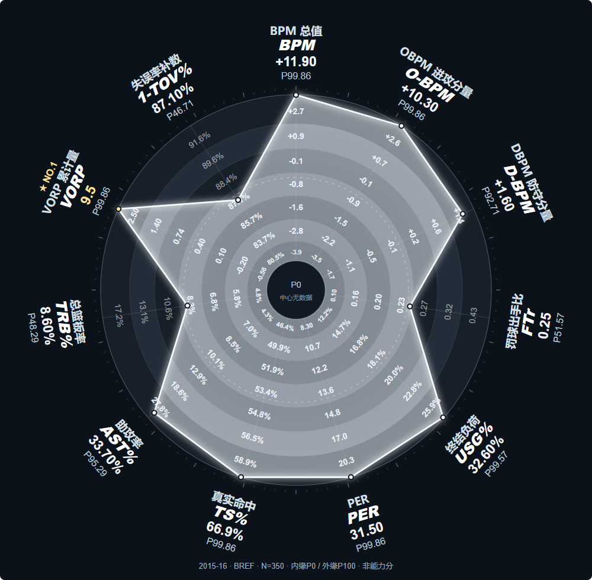

# NBA Player Analyst · v1.0.0

**用可追溯数据，写出有依据的 NBA 球员研究。**

[](https://github.com/hank14363-hub/nba-player-analyst/releases/tag/v1.0.0) [](requirements.txt) [](LICENSE)

一个面向 Codex 的 NBA 球员分析 Skill：围绕单赛季表现与战术适配，将统计、球评阅读与配图整理成**中文分析长文、交互式 HTML 研究册和结论长图**。原始证据、计算过程与结论依据一并保留，缺失数据明确标注。

An evidence-based Codex skill for NBA player research: traceable statistics, advanced percentile compasses, sourced commentary, and illustrated research books you can read offline.

[研究册预览](#研究册预览) · [下载](#下载-v100) · [快速开始](#快速开始) · [功能与数据](#功能与数据) · [文档](#文档入口) · [致谢](#致谢--acknowledgements)

## 研究册预览



库里 2015–16 真实案例：BR 十一轴、350 名同季合格球员。原值、百分位与参考刻度分别展示，图形面积不代表综合能力评分。

**体验完整交互**：下载并解压下方任一 Skill ZIP，在浏览器打开 `nba-player-analyst/examples/curry-2015-16-v100/research_book.html`，即可切换数据来源、查看逐轴解释、缩放并导出 SVG。GitHub 文件页展示 HTML 源码。

[研究册文件](examples/curry-2015-16-v100/research_book.html) · [BR 十一轴 SVG](examples/curry-2015-16-v100/charts/percentile_bref_compass_radar.svg) · [NBA 十轴 SVG](examples/curry-2015-16-v100/charts/percentile_nba_compass_radar.svg)

## 下载 V1.00

| 下载方式 | 适合谁 | 包含内容 |
|---|---|---|
| **[轻量运行包 · 约 7.8 MB](https://github.com/hank14363-hub/nba-player-analyst/releases/download/v1.0.0/nba-player-analyst-v1.0.0-runtime.zip)** | 安装使用、体验当前案例 | 全部运行代码、方法文档、当前库里案例与合成结构示例 |
| **[完整 Skill · 约 108 MB](https://github.com/hank14363-hub/nba-player-analyst/releases/download/v1.0.0/nba-player-analyst-v1.0.0-full.zip)** | 开发、测试、查看历史成果 | 运行包内容、完整回归测试与历史案例 |
| [主分支源码 ZIP](https://github.com/hank14363-hub/nba-player-analyst/archive/refs/heads/main.zip) | 获取最新仓库内容 | 包含发布后的文档更新；解压后将目录重命名为 `nba-player-analyst` |

[版本说明](https://github.com/hank14363-hub/nba-player-analyst/releases/tag/v1.0.0) · [两个发布 ZIP 的 SHA-256 校验文件](https://github.com/hank14363-hub/nba-player-analyst/releases/download/v1.0.0/SHA256SUMS.txt) · [更新记录](CHANGELOG.md)

保留整个文件夹结构。随包真实案例重放已保留的证据和抓取日期，包含配图、球评及来源限制；不代表本次重新联网采集。

## 快速开始

### 1. 安装 Skill

下载并解压，将整个 `nba-player-analyst` 文件夹放入 Codex 可发现的 skills 目录，根层须有 `SKILL.md`。Windows 常见目录结构：

```text
C:\Users\你的用户名\.codex\skills\nba-player-analyst\
├── SKILL.md
├── scripts/
├── assets/
├── references/
└── examples/
```

运行脚本需 **Python 3.10+**，联网依赖见 [requirements.txt](requirements.txt)。离线计算及 HTML/SVG 生成使用标准库；PNG/PDF 导出另需可选 Playwright 与浏览器。

### 2. 提出研究需求

在可使用该 Skill 的 Codex 对话中，指定球员、赛季、常规赛或季后赛，以及关注的问题：

> 使用 $nba-player-analyst 分析斯蒂芬·库里 2015–16 常规赛，重点研究投射、组织与球队适配。采集可用高阶数据，阅读相关球评，加入来源明确的球员图片，生成中文图文研究册。

### 3. 查看研究成果

| 文件 | 用途 |
|---|---|
| `research_book.html` | 内嵌图像与交互的离线研究册 |
| `report.md` | 可编辑的中文分析正文；配套保留 `charts/` |
| `player_poster.html` | 结论长图的 HTML 版，可按需导出 |
| `data_bundle.json`、`analysis.json`、`claims.json` | 数据、登记指标与结论依据 |
| 来源、原始文件与研究日志 | 回溯采集过程、文章采用情况与图片许可 |

完整流程见 [SKILL.md](SKILL.md)。脚本负责证据与模板；代理还需实际阅读资料、撰写正文、登记结论和选择配图，完成成稿校验。

## V1.00：进阶统计罗盘

| 变化 | 呈现与方法 |
|---|---|
| **分来源的统计画像** | 优先使用 BR 十一轴、NBA 十轴；扩展字段不全时退回同源六轴 |
| **可追溯的分位刻度** | 七层参考数值由保留的同季合格总体排序、线性插值得到；球员百分位单独采用中秩计算 |
| **更鲜明的视觉表达** | 明暗圆环、发光轮廓、切线标签、球员照片，以及独立核验后的单项第一高亮 |
| **能读懂的交互** | 逐轴解释、参考表、全图/放大、刻度开关、有限动效与独立 SVG 导出 |
| **兼顾多种阅读方式** | 手机、键盘、减少动画、无脚本与打印支持；旧成稿可在新目录迁移 |

**读图原则**：内缘 P0、外缘 P100，中心盘没有数据。越靠外表示数值百分位越高，需结合指标方向、职责与环境解释；不混源合成能力分。方法与迁移说明见 [罗盘文档](references/radar_compass.md)。

## 功能与数据

### 研究内容

| 功能 | 能做什么 |
|---|---|
| 球员特点与战术适配 | 按球员特点选择四项封面指标，将进攻、组织、角色与球队环境串联到正文 |
| 同角色比较与百分位 | 使用同源匹配总体，逐项保留样本量、门槛、方向及缺失说明 |
| 投篮分布与事件交互 | 使用真实投篮事件和坐标，核对 FGA/FGM/3PA/3PM，标注覆盖率与未定位事件 |
| 球评文章 | 代理搜索并阅读署名原文，登记采用/排除情况，回应作者观点并保留出处 |
| 图片与 GIF | 分层检索、原页核验、身份/日期/许可审查、本地保存与图注登记 |
| 录像观察 | 接入真实观看并登记的结构化观察记录，区分本研究观察与文章转述 |

### 数据来源与口径

| 数据类别 | 当前方式与边界 |
|---|---|
| NBA 基础、高阶、追踪及 On/Off | 官方接口或核验导入；追踪和投篮需显式开启；On/Off 需实际样本球队 ID，在场效率不等于个人因果影响 |
| BREF、LEBRON、DARKO | 在线默认尝试前两者；DARKO 需明确历史日期；单人模型数据不代表已有联盟分布 |
| Actual EPM | 合法离线导出或已核验的 Kaggle Actual 表独立导入，检查身份、赛季、GP、总分钟与分量 |
| 历史 EPM | 保留原日期、Kaggle 转引及“口径待核验”说明；不等同于整季 Actual 或同日预测，不用于能力雷达 |
| Kaggle / Sumitro | 保留原始文件/行与哈希，核验姓名、NBA ID 桥接及统计定义；仅支持已适配的数据结构 |

来源可用性取决于网络、权限与历史覆盖。缺失指标不补零、不用其他球员或演示数据替代；没有可靠坐标就不画热区，没有合格比较总体就不生成对应百分位。图片、球评或雷达受限时，研究册如实说明原因。

## 脚本与校验

以下命令中的 `<SKILL_DIR>` 为 Skill 根目录，`<新目录>` 为新的研究输出目录。带空格的实际路径请加引号。

<details>
<summary><strong>采集与离线导入</strong></summary>

安装联网依赖，并显式开启追踪与投篮采集：

```text
python -m pip install -r <SKILL_DIR>/requirements.txt
python <SKILL_DIR>/scripts/run_analysis.py --player-id <NBA_ID> --season <YYYY-YY> --tracking --shots --out <新目录>
```

已有匹配数据包时，离线重放：

```text
python <SKILL_DIR>/scripts/run_analysis.py --input <旧目录>/data_bundle.json --player-id <NBA_ID> --season <YYYY-YY> --out <新目录>
```

`--input` 不联网；缺表可通过 `repair_data.py` 在新目录补采。`--offline` 仅读缓存并保留实际抓取时间。按研究范围可使用 `--no-impact`、`--no-comparisons` 或 `--no-advanced-percentiles`。

</details>

<details>
<summary><strong>成稿、研究册与长图校验</strong></summary>

先完成 `report.md`、`claims.json`、`book_content.json` 与 `poster_content.json`。采用影像时，还需媒体文件、来源与研究日志。

```text
python <SKILL_DIR>/scripts/validate_report.py --run-dir <目录>
python <SKILL_DIR>/scripts/render_research_book.py --run-dir <目录> --theme auto
python <SKILL_DIR>/scripts/validate_book.py --run-dir <目录> --strict-editorial
python <SKILL_DIR>/scripts/render_player_poster.py --run-dir <目录> --theme auto
python <SKILL_DIR>/scripts/validate_poster.py --run-dir <目录>
```

修改内容后，用 `--force` 重建派生文件，再检查桌面、手机、图注与来源跳转。自动检查验证结构、数字与重放一致性；因果解释和篮球判断仍需人工审阅。

</details>

<details>
<summary><strong>升级旧雷达、运行测试与打包</strong></summary>

升级已完成的百分位研究册：

```text
python <SKILL_DIR>/scripts/upgrade_radar.py --run-dir <旧成稿目录> --out <不存在的新目录>
```

迁移工具先验证旧成稿和原始文件，拒绝覆盖与旧指标改变，保留正文、球评、照片和抓取日期。新请求保存 `radar_protocol=1.0.0`；数据/claims、book、poster 结构版本各自独立。

完整回归与分发：

```text
python -m unittest discover -s <SKILL_DIR>/tests -v
python <SKILL_DIR>/scripts/check_release.py
python <SKILL_DIR>/scripts/package_skill.py --profile full --out <Skill目录之外的新ZIP路径>
python <SKILL_DIR>/scripts/package_skill.py --profile runtime --out <Skill目录之外的另一新ZIP路径>
```

两个分发包运行代码一致，均附 `DISTRIBUTION.json` 和逐文件 SHA-256。运行包省略历史案例与 tests，文档中的历史案例路径需使用完整包。V1.00 发布时 **674 项离线回归通过**，真实库里与詹姆斯案例的图表、交互验证范围见下方记录。

</details>

## 文档入口

| 想了解什么 | 从这里开始 |
|---|---|
| 完整研究流程 | [SKILL.md](SKILL.md) |
| 来源、指标与补数 | [数据源](references/data_sources.md) · [指标定义](references/metrics.md) · [缺失修复](references/data_repair.md) |
| 导入已有数据 | [标准输入](references/input_schema.md) · [Kaggle](references/kaggle_import.md) · [Sumitro](references/sumitro_import.md) |
| 影响力与 EPM | [模型说明](references/impact_models.md) · [Actual 导入](references/epm_import.md) · [历史 EPM](references/kaggle_epm.md) |
| 比较与罗盘 | [同角色比较](references/role_comparisons.md) · [百分位](references/advanced_percentiles.md) · [V1.00 罗盘](references/radar_compass.md) |
| 文章、图片与排版 | [球评阅读](references/commentary_research.md) · [图片检索](references/image_research.md) · [研究册](references/research_book.md) · [成稿检查](references/research_completion.md) |
| 版本与验证 | [更新记录](CHANGELOG.md) · [测试记录](TEST_REPORT.md) · [V1.00 验证](documentation/validation_v100.md) · [分发检查](PACKAGE_VALIDATION.md) |
| 后续发展 | [发展路径](references/development_roadmap.md) · [罗盘方法与扩展](references/radar_compass.md) |

## 致谢 / Acknowledgements

特别感谢 **[zxuu's API](https://api.zxuu.de/dashboard/overview)** 为本项目的开发与持续迭代提供 API 支持。

Special thanks to **[zxuu's API](https://api.zxuu.de/dashboard/overview)** for providing API support for the development and continued improvement of this project.

同时感谢数据提供者、球评作者、摄影作者，以及开源工具与视觉参考的贡献者。设计参考、图片署名及许可说明见 [ACKNOWLEDGEMENTS.md](ACKNOWLEDGEMENTS.md)，具体素材来源保留在各案例中。

## 许可

代码采用 [MIT License](LICENSE)。图片、统计数据及其他第三方内容适用各自的来源许可；案例保留署名、日期、许可链接与用途限制，仓库的 MIT 许可不改变第三方内容的许可。
