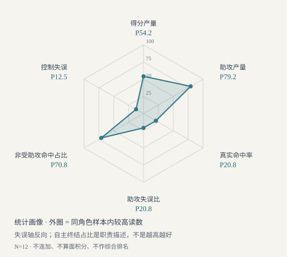
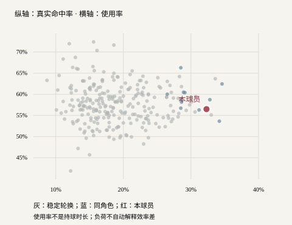
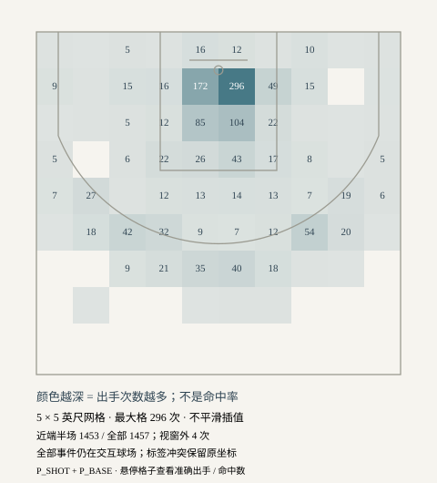
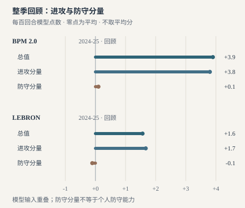
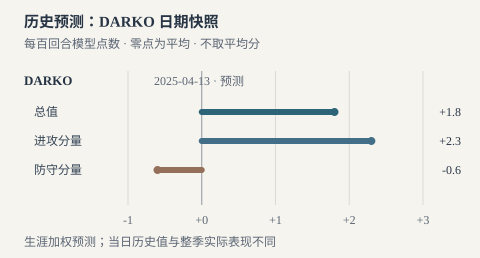

# 坎宁安：进攻组织的核心，效率与无球仍是关键问题

> 2024—25赛季常规赛 · NBA Stats 官方数据 · 原始数据采集于2026年10月12日，本轮沿用已保存的原始表；不代表当前赛季。

本研究将得分、组织、真实出手、同角色比较与球队背景放在一起。最新比较显示，坎宁安的组织产量与自主终结职责较突出，效率和失误仍是需要面对的代价；这些差异让使用建议更具体，但不能直接证明个人因果贡献或防守能力。

> 阅读顺序：先确认他承担的任务，再读效率与出手位置，随后看组织、接球任务和球队在场表现。最后的使用建议是试验方案，不能把历史照片或一张统计图当成已验证的比赛答案。

## 一、他承担了什么任务

坎宁安出场70场，场均35.03分钟，得到26.14分、9.11次助攻，同时有4.41次失误。 [P_BASE]

这些数字首先说明他参与了大量进攻的结束和传递。得分与助攻放在一起，比单看得分更接近球队交给他的工作；失误也必须同时考虑，因为一次没有形成出手的进攻同样有代价。这里不把得分、助攻与失误相加成“实力分”，它们衡量的是不同事件。

官方使用率为32.3%，助攻率为40.9%。 [P_ADV]

使用率大致描述他在场时，以出手、罚球和失误结束进攻的份额；它不等于持球时间。助攻率描述他在场时队友的投篮命中中由他助攻的估计比例，也不等于一次传球变成助攻的概率。两者共同支持讨论他的核心组织职责，但不能单独证明阅读防守的速度。

最有依据的定位，是在本赛季承担主要进攻发起和终结职责；是否能在更强对手与更紧空间下保持同样质量，需要回合层面的证据。 [P_ADV][P_BASE]

## 二、得分产量可观，效率没有领先联盟

真实命中率为56.5%，同赛季联盟整体为57.6%，按未舍入数值计算低1.13个百分点。 [P_BASE][T_BASE]

真实命中率综合考虑两分、三分和罚球的得分结果。联盟基准来自所有球队的总得分与总出手，不是把不同球员的百分比直接平均。对一名承担大量发起任务的球员，稍低于总体基准与进攻价值仍然可以同时存在；总体基准没有按出手难度或职责作调整，所以也不能据此判定他的技术不如某位低负荷终结者。

![效率低于联盟总体；这个基准没有按进攻职责校正。[P_BASE][T_BASE]](charts/efficiency.svg)

三分占投篮出手的28.7%，三分命中率为35.6%。 [P_BASE]

他的出手结构以两分为主，三分是参与进攻的一部分。球队应研究哪些机会值得保留、哪些急停出手可以由更好的传导替代，而不是为了追求单项命中率简单减少他的组织工作。两分与三分构成图描述球的价值类别；下面新增的真实位置图才回答从哪里出手。区域结果依然没有控制防守压力，不能直接给出哪个区域的技术能力最强。得分来源图只拆分两分、三分和罚球，不能当成挡拆与单打占比。

![两分与三分是出手结构，不是球场位置分布。[P_BASE]](charts/shot_mix.svg)

把产量与效率放在同一张图里，是为了避免两种常见误读：因为得分多而忽略机会成本，或者因为总体效率没有领先就否认主要发起任务的价值。真正值得问的是，哪些终结来自他创造了防守缺口，哪些是队友未能创造机会后的收尾。前一种更接近可保留的核心工作，后一种需要放回球队配合和进攻时钟里看。

## 三、真实位置让出手结构更具体

逐次投篮数据覆盖70场、1457次出手与684次命中，出手与命中总数均匹配基础统计。 [P_BASE] [P_SHOT]

散点图保留每次实际出手，圆点为命中、叉号为未中。使用全场等比例，远距离出手也显示在原坐标位置；同一点重复出手会重叠，因此散点用于观察位置，精确计数仍以区域表为准。颜色描述一次出手的结果，不是能力高低。

![真实位置来自全部逐次出手；远距出手保留，重叠点不用于精确数数。[P_SHOT][P_BASE]](charts/shot_locations.svg)

合理冲撞区为207次命中、364次出手，命中率56.9%；油漆区其余位置为241次命中、483次出手，命中率49.9%；中距离为86次命中、191次出手，命中率45.0%。 [P_BASE] [P_SHOT]

合理冲撞区是篮筐附近的官方区域，不能把其他油漆区出手全部当成同样容易的篮下机会。中间距离有较多出手，提示值得查看他在什么压力下选择了这些终结；单看命中率没有纳入进攻时钟、造罚球和传球后果，无法判断每次出手是否合理，也不足以推断与同职责球员相比的优劣。

左底角三分为4中12，右底角为4中9；弧顶及两翼三分为141中393，另有4次后场出手全部未中；还有1条区域与投篮类型标签冲突记录被单列。 [P_BASE] [P_SHOT]

两个底角的样本都很少，左右差异可能被少数投篮改变。官方区域和两三分标签发生冲突的出手仍保留原值，区域表把它单列，避免擅自改成三分；它仍计入总体出手与命中。各区域的命中数、出手数全部公开，条长表示出手份额，读者可以分开判断使用频率和结果。

![命中数/出手数说明分母；条长是出手份额，标签冲突记录单列。[P_SHOT][P_BASE]](charts/shot_zones.svg)

更适合继续验证的方向，是减少部分受压的中间距离终结、保留能创造优势的突破与传球，而非凭区域命中率直接规定所有出手的增减。 [P_BASE] [P_SHOT] [TR_PASS]

要检验这个方向，应比较相似防守压力、相似剩余时间的回合：继续终结、提前出球以及再次接球各有什么结果。只有看到可重复的选择问题，才讨论具体调整。没有同口径联盟区域基准，本报告不给某一区域贴上联盟领先或落后的标签。

## 四、组织产出与失误需要一起读

按官方每百回合数据换算，每75回合为26.40分、9.23次助攻与4.43次失误；赛季助攻失误比为2.06。 [P_100][P_BASE]

统一回合数量有助于减少节奏对场均数字的影响。官方每百回合原值已经舍入，因此换算后的细小差别不应解释为能力变化。助攻多与失误多可能来自频繁承担处理球任务，也可能来自部分回合选择不佳；需要把受压传球、突破中的丢球、进攻犯规等情形分开观察。

追踪数据记录场均15.00次潜在助攻和23.40次突破。 [TR_DRIVE][TR_PASS]

潜在助攻通常指传给队友后紧接投篮的机会，即使球没有投进也会计入；它更接近传球形成出手机会的数量，但仍不衡量机会是否足够好。突破次数反映进攻参与方式，也不能直接证明每次都突破了防守第一线。两项追踪资料都覆盖同一赛季的七十场，使用提供者原始场均口径，不乘场次伪造精确总数。

减轻部分连续发起负担、保留他的关键处理球任务，是值得尝试的分工；需要确认分担者能创造有效机会，而非只是替他运球。 [P_100][TR_PASS]

![共同回合尺度帮助读懂工作量，三个事件不能相加成综合评分。[P_100]](charts/creation.svg)

阅读组织能力还要分开“第一次让防守发生变化”和“把已经出现的机会传出去”。潜在助攻可以提示传球形成出手的频率，却没有告诉我们防守最初为什么移动。下一轮记录回合时，应关注接球人的空间、传球窗口、弱侧是否被迫协防，以及球传出后进攻能否继续。失误也要区分强行挑战防守、接应路线被堵和队友处理失误，才能把改进任务具体地交给球员或球队。

## 五、受助攻与接球投篮终于有了独立证据

全部投篮命中中30.3%受助攻、69.7%未记助攻；三分命中中57.0%受助攻。 [P_SCORE]

这说明他投进的球里，非受助攻的部分较大，三分命中则更常伴随队友助攻。没有记助攻的命中不等于单打；记了助攻也不等于把所有接球投篮都统计了进来。尤其不能用命中球结构反推失败出手的结构。相比旧版明确留空，这一张图补充了确切的进球来源信息，但它没有回答跑位质量和防守牵制。

![分母是命中球；不能把受助攻占比改叫接球投篮效率。[P_SCORE]](charts/assisted.svg)

场均接球投篮出手2.20次，有效命中率56.1%；持球急停出手7.80次，有效命中率49.4%。 [TR_CATCH][TR_PULL]

有效命中率给三分命中增加权重，只看投篮，不含罚球。接球出手的结果较好，适合支持尝试让他在部分回合接球后继续进攻；但接球和急停的距离、难度、防守压力不同，不能把两条柱子解释成他无球技术强于持球技术。接球样本也更少，短期手感会更明显地影响读数。

较合理的无球试验，是在另一名球员发起时保留他的接球投篮与接球再处理任务，而不是仅凭受助攻数据认定他已经是成熟的跑位终结者。 [P_SCORE][TR_CATCH]

![有效命中率描述不同出手机会的结果；出手类型、数量与难度不同。[TR_CATCH][TR_PULL]](charts/tracking.svg)

接球后参与进攻可以有不同任务。直接出手看准备速度与防守压力；继续突破看防守是否已失去平衡；快速转移则看下一名队友能否获得更好的角度。把这些任务混成一个“无球能力”结论，会掩盖不同的训练和配合要求。更实际的做法，是先安排一种清晰任务，记录它在相似防守下能否反复产生合理选择，再决定扩大还是收回。

## 六、真正的在场对比强化进攻线索，没有解决个人防守

他在场时活塞每百回合得分115.0、失分112.2、净胜2.8；不在场时对应为109.7、109.9与净负0.2。 [P_ONOFF]

在场减不在场的净效率差为正3.0分，其中进攻得分高5.3分，防守失分也高2.3分。 [P_ONOFF]

这里的不在场数据来自真正的 Off 行，而不是用球队整体平均替代。球队在场分钟与不在场分钟覆盖同一赛季球队样本，球员在场分钟也与基础统计匹配。进攻方向较明确，防守方向却没有同步改善，这是比只看净差更重要的信息。

这组在场对比支持继续研究他与球队进攻之间的关系，但不能把净效率差写成个人贡献，也不能用在场失分高证明他个人防守差。 [P_ONOFF]

同一名球员可能在场上承担不同对位和帮助任务，替补时段也可能面对不同强度的对手。个人防守需要对位、绕掩护、弱侧补位和退防的录像证据。抢断与封盖可以描述事件数量，却无法独立回答这些问题，所以本报告仍然不给个人防守评分。

![在场时进攻得分与防守失分都更高；正防守失分差不表示防守改善。[P_ONOFF]](charts/onoff.svg)

个人防守的观察也应先确认任务。面对掩护时，他被要求绕过、换防还是暂时延误？弱侧补位时，篮下保护和底角轮转由谁接手？如果不知道这些约定，只看最后谁离投篮者最近，很容易把整套轮转的问题归到单个球员。可以先比较同类任务中的成功与失败：起始站位、注意力、沟通和回位路线是否出现可重复差别。这样才能从“球队失了分”走向具体的训练建议。

## 七、怎样把统计结论变成可验证的球队分工

在本赛季环境中，保留核心发起职责，同时增加能衔接进攻的第二处理点、给予接球后继续处理的机会，是比简单削减球权更有依据的使用建议。 [P_100][P_ADV][P_ONOFF][TR_CATCH]

成立条件是其他处理点能让防守先移动，接球者能继续投、突、传，队友也能把他创造的机会转化为合理出手。代价是分工改变可能打断原有节奏，减少核心处理球并不保证机会变好。验证时应同时看创造出的投篮质量、失误类型以及回合末是否仍需要他救场，而不是只盯助攻或命中率。

下一步录像研究应优先覆盖不同强度的防守：面对压迫与夹击时的传球选择、从弱侧接球后的第一步决策，以及有球与无球防守中的任务完成情况。预先记录比赛、节次与时间码，并保留成功和失败样本。若减轻发起负担后进攻机会并未改善，就应修正分工建议；若他在接球后仍能持续创造优势，才有理由扩大这种职责。

## 八、把使用建议放到具体回合里

### 分担发起：先移动防守，再交回处理

分担发起时，可先让另一名处理点借掩护迫使防守移动，再由坎宁安接球决定投、突或传；是否减少低质量终结，需要比较相近压力下的回合。 [P_100] [P_ADV] [TR_CATCH]

这里的第二处理点需要能造成防守反应，而不只是替他带球过半场。掩护后的持球者、接应中锋和弱侧射手要形成连续选择；球回到坎宁安手中时，应有明确的接球位置和下一步空间。如果另一个发起点无法制造优势，分工调整可能只是把同样困难的收尾推迟，甚至压缩剩余处理时间。比较时应关注传球后的机会质量与失误原因，而不只看谁最后得分。

### 接球再处理：让无球参与有后续

当队友启动进攻时，可以试验让他从弱侧接球后立即继续处理，保留接球投篮与再突破的选择；不应仅凭受助攻比例把他固定成静态定点射手。 [P_SCORE] [TR_CATCH] [TR_DRIVE]

这个安排依赖前置进攻能让防守先移动。接球者可以直接投，也可以利用防守回位继续突破，或者把球传到防守刚刚让出的区域。要保留这些选择，队友需要理解接球后可能发生什么，避免同时占据同一条突破或接应路线。如果防守仍然站稳、队友没有后续接应，单纯减少持球不会自动创造更好的机会。

### 回合末：区分选择问题与被迫收尾

对回合末的困难出手，应先区分体系已经创造出的机会与被迫收尾；只有前者持续出现可替代选择，才有理由减少相应的中间距离终结。 [P_BASE] [P_SHOT]

区域表可以帮我们找到值得看的出手，却不能单独判定选择失当。应把回合前面的传导、掩护与接应一起纳入：是否存在可以提前出球的窗口，窗口持续多久，接球者是否有继续处理的条件。若困难终结主要发生在球队进攻停滞之后，改进可能首先在前面的组织；若有合理替代方案却反复被忽略，才更接近个人决策任务。这些情形目前都等待真实录像核验。

## 九、与署名球评对读：把描述变成验证问题

外部评论可以帮助我们提出更具体的问题，但不能拿声誉或措辞替代证据。以下直接查阅三位作者的文章，使用中文概括，不转载全文。三篇来自同一媒体，属于补充视角而非独立共识；赛季中期与季后赛前瞻的数字没有混入本文完整常规赛统计。

### 队友空间也是研究对象

Blake Silverman 在赛季中期评论中，把坎宁安的进步与补强外线空间、年轻队友成长及教练变化一起讨论，而非将球队跃升完全归因于单个球员。 [EXT_SILVERMAN]

这让“增加第二处理点”不再只是人数安排。分担者先让防守回应，接应者再把机会延续，才能讨论坎宁安接回球时是否更容易选择。只看核心的助攻与失误，容易漏掉队友的接球位置和终结条件。本研究据此把阵容空间作为待观察背景，尚不将补强与进步写成已识别的因果关系。

### 处理挡拆的节奏，需要回到动作

Liam McKeone 在季后赛前瞻中强调坎宁安借身材观察防守、按自己的节奏处理挡拆的特点，也将失误列为季后赛需要面对的问题。 [EXT_MCKEONE]

“按自己的节奏”值得拆成可记录的环节：等待掩护、观察协防、改变速度和送球窗口。相同的停顿可能是在等待更好机会，也可能错过已有接应，只有完整回合才能区分。作者文中还讨论防守表现，但本研究不会将其描述或阶段数据转为个人防守评分；这里采用的是观察问题，不是沿用作者所有评价。

### 到球时机是机会质量的一部分

Dan Lyons 的赛季结束报道转述了坎宁安对组织责任的自述：帮助队友到达合适位置，并在他们需要的时候把球送到，是他最看重的进步。 [EXT_LYONS]

这段自述提示我们在潜在助攻之外记录队友接球后的处境：是否能够顺势投篮、是否有继续突破的通道，以及防守是否已重新站稳。它不能证明传球时机确实改善，但能帮助检验“队友没有投进”之外的解释。研究应保留及时和不及时的样本，再判断需要调整传球执行，还是前面的接应安排。

## 十、同角色比较：组织优势与效率代价是否同时存在

仅和联盟平均比较，会把任务差异压成一个数字。这里改用明确的功能型门槛：先筛出常规赛至少四十场、一千总分钟的稳定轮换，再要求使用率不低于百分之二十五、助攻率不低于百分之三十。门槛先确定，不根据坎宁安的排名倒推。它会纳入后卫、锋线和承担组织职责的中锋，因此应称“高负荷组织核心”，不能声称每个人都打相同位置或面对相同防守。

完整原始表覆盖569名球员；统一出勤筛选后有266名稳定轮换，主比较样本纳入12名高负荷组织核心。 [P_100][P_ADV][P_BASE][P_SCORE]

纳入名单与总分钟、出勤、角色阈值及全部比较读数一并保留。转会球员用整季合计，来源的最新球队标签仅作检索线索；不能据此把整季数据归属于最后一支球队。基础、进阶、每百回合与受助攻表的球员身份覆盖完全一致，来源行数和摘要也经过核验。

坎宁安每75回合助攻9.23次，同角色中位数为8.18次；助攻产量统计百分位为P79.2。 [P_100][P_ADV][P_BASE][P_SCORE]

非受助攻命中占比为69.7%，同角色中位数为63.3%；对应统计百分位为P70.8。 [P_100][P_ADV][P_BASE][P_SCORE]

这两条线索共同支持组织与自主终结并存的角色判断。第一条是助攻结果产量，第二条的分母是已经投进的球；都没有记录每次进攻的防守难度。高自主终结占比也可能意味着队友难以提供轻松机会，不能把占比越高写成能力越强。

每75回合得分26.40分，同角色中位数为26.18分；得分产量统计百分位为P54.2。 [P_100][P_ADV][P_BASE][P_SCORE]

真实命中率56.5%，同角色中位数58.8%，统计百分位P20.8；助攻失误比2.06，同角色中位数2.18，统计百分位同为P20.8。 [P_100][P_ADV][P_BASE][P_SCORE]

每75回合失误4.43次，同角色中位数3.71次；将失误轴按“更少更靠外”反向后，控制失误统计百分位为P12.5。 [P_100][P_ADV][P_BASE][P_SCORE]

这让“组织核心已经成立，终结与决策成本仍需改善”的判断更有支撑。助攻较多并没有同时带来领先的助攻失误比；得分产量在这组高负荷组织者中接近中部，效率则更靠后。下一步应查失误发生在第一拍突破、受到夹击后的出球，还是回合末被迫处理，再决定第二处理点要分担哪种任务。这里不把技术统计差异直接归因为决策水平，也不声称失误减少后球队进攻必然改善。

百分位采用同组经验分布的同值中秩，包含本人。控制失误轴反向，其余轴按读数升序；自主终结轴只描述角色。图中面积没有篮球上的计量意义，六条轴不能相加。某项靠外表示这份样本里的读数更靠前，既不是能力超过联盟某比例球员的概率，也不是跨赛季稳定能力。

放宽角色门槛后样本为27人，助攻产量百分位P90.7、真实命中率百分位P42.6；提高使用率门槛后样本为11人，对应为P77.3与P22.7。 [P_100][P_ADV][P_BASE][P_SCORE]

宽口径要求使用率至少百分之二十三、助攻率至少百分之二十五，严格口径提高使用率至百分之二十八，其余出勤门槛保持一致。助攻产量在三组中都较靠前，效率位置则明显受比较对象影响。因此结论应保留“组织产量突出、效率尚未形成同角色优势”的方向，避免给一个看似精确且不随样本变化的实力名次。

## 十一、空间与影响力证据：补齐能够回答的部分

已核验1457次真实投篮事件，频次热区以固定网格逐格统计出手次数；颜色不表示命中率、联盟相对效率或投射能力。 [P_BASE][P_SHOT]

热区回答的是出手聚在哪里。密集区域可能是主动攻击点，也可能是防守给予的机会；它无法单独说明哪种原因更重要。读图时先从高频区域跳回逐次出手和比赛列表，再结合已保留的命中与未中事件定位问题。同口径联盟区域基准目前尚未取得，因此没有把频次涂色包装成相对联盟的效率热区。

NBA 官方 PIE 为15.2%，同角色样本中位数为14.3%。 [P_100][P_ADV][P_BASE][P_SCORE]

PIE 是技术统计事件贡献份额指标，可提供与单看得分不同的观察线索；它受角色、队友分工和场上事件环境影响，不是调整过阵容与对手的个人净贡献。它与效率、失误、球队在场表现并列展示，不被用来覆盖效率短板或推导个人防守能力。

本次核验的历史实际 EPM 入口跳转至订阅页面；尚未取得可用于本册完整常规赛样本的坎宁安实际 EPM 值。 [EXT_EPM_ACCESS]

新增的提供者模型在后文单独说明，保留整季回顾与日期预测、分钟核验和方法边界。球队 On/Off 与 PIE 仍按各自定义展示。综合分和联盟实力排名继续不提供；不同模型并列能检验方向，任意加权会引入研究者自己的价值判断。

## 十二、为什么封面选择这四项

封面选用助攻率40.9%、非受助攻命中占比69.7%、场均突破23.4次和每75回合得分26.40分，分别体现组织覆盖、自主终结结构、突破参与和得分产量。 [P_100][P_ADV][P_SCORE][TR_DRIVE]

这四项是这名球员的阅读入口，效率和失误紧接着在正文及比较画像中出现。纯射手会优先展示三分命中率、三分出手占比和接球投篮结果；篮板职责明显的球员会优先展示前后场篮板率与回合尺度篮板产量。自动选择仅依据可用数据和公开规则，作者也可覆盖选择，但每项都必须连到登记过的正文依据，不能换成没有来源的“特色能力值”。

## 数据口径与可复现说明

本次基础、进阶、每百回合、受助攻、球队与追踪资料均来自实际访问的 NBA Stats；此前第三方导入案例保留在历史目录。本次官方使用率、助攻率与每回合数据和旧案例估计值不同，全文统一使用本次官方口径。高级与受助攻响应中的场均分钟经过基础总分钟核验，原始返回值没有改写。本轮新增真实投篮位置与区域统计，并保留标签冲突记录；没有补造联盟排名、影片观察或个人防守评分。录像模板当前为空，待验证计划不能当成观看结果。程序检查确认复算与引用，不能替代对战术建议的实际验证。新增赛场影像拍摄于较早年份，按摄影者与授权单独列出；动态照片轮播不是连续比赛录像，不用于证明本赛季的技术表现。

[P_BASE]: https://stats.nba.com/stats/leaguedashplayerstats?LastNGames=0&MeasureType=Base&Month=0&OpponentTeamID=0&PaceAdjust=N&PerMode=Totals&Period=0&PlusMinus=N&Rank=N&Season=2024-25&SeasonType=Regular+Season&College=&Conference=&Country=&DateFrom=&DateTo=&Division=&DraftPick=&DraftYear=&GameScope=&GameSegment=&Height=&LeagueID=00&Location=&Outcome=&PORound=&PlayerExperience=&PlayerPosition=&SeasonSegment=&ShotClockRange=&StarterBench=&TeamID=&TwoWay=&VsConference=&VsDivision=&Weight= "NBA Stats via nba_api | 2026-10-12T01:56:56+00:00"
[P_ADV]: https://stats.nba.com/stats/leaguedashplayerstats?LastNGames=0&MeasureType=Advanced&Month=0&OpponentTeamID=0&PaceAdjust=N&PerMode=Totals&Period=0&PlusMinus=N&Rank=N&Season=2024-25&SeasonType=Regular+Season&College=&Conference=&Country=&DateFrom=&DateTo=&Division=&DraftPick=&DraftYear=&GameScope=&GameSegment=&Height=&LeagueID=00&Location=&Outcome=&PORound=&PlayerExperience=&PlayerPosition=&SeasonSegment=&ShotClockRange=&StarterBench=&TeamID=&TwoWay=&VsConference=&VsDivision=&Weight= "NBA Stats via nba_api | 2026-10-12T02:01:19+00:00"
[P_100]: https://stats.nba.com/stats/leaguedashplayerstats?LastNGames=0&MeasureType=Base&Month=0&OpponentTeamID=0&PaceAdjust=N&PerMode=Per100Possessions&Period=0&PlusMinus=N&Rank=N&Season=2024-25&SeasonType=Regular+Season&College=&Conference=&Country=&DateFrom=&DateTo=&Division=&DraftPick=&DraftYear=&GameScope=&GameSegment=&Height=&LeagueID=00&Location=&Outcome=&PORound=&PlayerExperience=&PlayerPosition=&SeasonSegment=&ShotClockRange=&StarterBench=&TeamID=&TwoWay=&VsConference=&VsDivision=&Weight= "NBA Stats via nba_api | 2026-10-12T01:57:48+00:00"
[P_SCORE]: https://stats.nba.com/stats/leaguedashplayerstats?LastNGames=0&MeasureType=Scoring&Month=0&OpponentTeamID=0&PaceAdjust=N&PerMode=Totals&Period=0&PlusMinus=N&Rank=N&Season=2024-25&SeasonType=Regular+Season&College=&Conference=&Country=&DateFrom=&DateTo=&Division=&DraftPick=&DraftYear=&GameScope=&GameSegment=&Height=&LeagueID=00&Location=&Outcome=&PORound=&PlayerExperience=&PlayerPosition=&SeasonSegment=&ShotClockRange=&StarterBench=&TeamID=&TwoWay=&VsConference=&VsDivision=&Weight= "NBA Stats via nba_api | 2026-10-12T02:42:45+00:00"
[T_BASE]: https://stats.nba.com/stats/leaguedashteamstats?LastNGames=0&MeasureType=Base&Month=0&OpponentTeamID=0&PaceAdjust=N&PerMode=Totals&Period=0&PlusMinus=N&Rank=N&Season=2024-25&SeasonType=Regular+Season&Conference=&DateFrom=&DateTo=&Division=&GameScope=&GameSegment=&LeagueID=00&Location=&Outcome=&PORound=&PlayerExperience=&PlayerPosition=&SeasonSegment=&ShotClockRange=&StarterBench=&TeamID=&TwoWay=&VsConference=&VsDivision= "NBA Stats via nba_api | 2026-10-12T01:57:51+00:00"
[T_ADV]: https://stats.nba.com/stats/leaguedashteamstats?LastNGames=0&MeasureType=Advanced&Month=0&OpponentTeamID=0&PaceAdjust=N&PerMode=Totals&Period=0&PlusMinus=N&Rank=N&Season=2024-25&SeasonType=Regular+Season&Conference=&DateFrom=&DateTo=&Division=&GameScope=&GameSegment=&LeagueID=00&Location=&Outcome=&PORound=&PlayerExperience=&PlayerPosition=&SeasonSegment=&ShotClockRange=&StarterBench=&TeamID=&TwoWay=&VsConference=&VsDivision= "NBA Stats via nba_api | 2026-10-12T01:57:51+00:00"
[TR_CATCH]: https://stats.nba.com/stats/leaguedashptstats?LastNGames=0&Month=0&OpponentTeamID=0&PerMode=PerGame&PlayerOrTeam=Player&PtMeasureType=CatchShoot&Season=2024-25&SeasonType=Regular+Season&College=&Conference=&Country=&DateFrom=&DateTo=&Division=&DraftPick=&DraftYear=&GameScope=&Height=&LeagueID=00&Location=&Outcome=&PORound=&PlayerExperience=&PlayerPosition=&SeasonSegment=&StarterBench=&TeamID=&VsConference=&VsDivision=&Weight= "NBA Stats via nba_api | 2026-10-12T01:57:55+00:00"
[TR_PULL]: https://stats.nba.com/stats/leaguedashptstats?LastNGames=0&Month=0&OpponentTeamID=0&PerMode=PerGame&PlayerOrTeam=Player&PtMeasureType=PullUpShot&Season=2024-25&SeasonType=Regular+Season&College=&Conference=&Country=&DateFrom=&DateTo=&Division=&DraftPick=&DraftYear=&GameScope=&Height=&LeagueID=00&Location=&Outcome=&PORound=&PlayerExperience=&PlayerPosition=&SeasonSegment=&StarterBench=&TeamID=&VsConference=&VsDivision=&Weight= "NBA Stats via nba_api | 2026-10-12T01:57:57+00:00"
[TR_PASS]: https://stats.nba.com/stats/leaguedashptstats?LastNGames=0&Month=0&OpponentTeamID=0&PerMode=PerGame&PlayerOrTeam=Player&PtMeasureType=Passing&Season=2024-25&SeasonType=Regular+Season&College=&Conference=&Country=&DateFrom=&DateTo=&Division=&DraftPick=&DraftYear=&GameScope=&Height=&LeagueID=00&Location=&Outcome=&PORound=&PlayerExperience=&PlayerPosition=&SeasonSegment=&StarterBench=&TeamID=&VsConference=&VsDivision=&Weight= "NBA Stats via nba_api | 2026-10-12T01:57:58+00:00"
[TR_DRIVE]: https://stats.nba.com/stats/leaguedashptstats?LastNGames=0&Month=0&OpponentTeamID=0&PerMode=PerGame&PlayerOrTeam=Player&PtMeasureType=Drives&Season=2024-25&SeasonType=Regular+Season&College=&Conference=&Country=&DateFrom=&DateTo=&Division=&DraftPick=&DraftYear=&GameScope=&Height=&LeagueID=00&Location=&Outcome=&PORound=&PlayerExperience=&PlayerPosition=&SeasonSegment=&StarterBench=&TeamID=&VsConference=&VsDivision=&Weight= "NBA Stats via nba_api | 2026-10-12T01:57:59+00:00"
[P_ONOFF]: https://stats.nba.com/stats/teamplayeronoffsummary?TeamID=1610612765&LastNGames=0&MeasureType=Advanced&Month=0&OpponentTeamID=0&PaceAdjust=N&PerMode=Totals&Period=0&PlusMinus=N&Rank=N&Season=2024-25&SeasonType=Regular+Season&DateFrom=&DateTo=&GameSegment=&LeagueID=00&Location=&Outcome=&SeasonSegment=&VsConference=&VsDivision= "NBA Stats via nba_api | 2026-10-12T02:01:22+00:00"
[P_SHOT]: https://stats.nba.com/stats/shotchartdetail?TeamID=0&PlayerID=1630595&ContextMeasure=FGA&LastNGames=0&LeagueID=00&Month=0&OpponentTeamID=0&Period=0&SeasonType=Regular+Season&AheadBehind=&ClutchTime=&ContextFilter=&DateFrom=&DateTo=&EndPeriod=&EndRange=&GameID=&GameSegment=&Location=&Outcome=&PlayerPosition=&PointDiff=&Position=&RangeType=&RookieYear=&Season=2024-25&SeasonSegment=&StartPeriod=&StartRange=&VsConference=&VsDivision= "NBA Stats via nba_api | 2026-10-12T02:43:03+00:00"

[EXT_SILVERMAN]: https://www.si.com/nba/four-reasons-behind-pistons-emergence-nba-best-surprise-season "Blake Silverman | 2025-03-07T13:00:02Z"
[EXT_MCKEONE]: https://www.si.com/nba/cade-cunningham-amen-thompson-exciting-nba-playoff-debuts-2025 "Liam McKeone | 2025-04-11T15:05:33Z"
[EXT_LYONS]: https://www.si.com/nba/pistons-cade-cunningham-classy-remark-biggest-accomplishment-strong-season "Dan Lyons | 2025-05-02T12:01:35Z"

[EXT_EPM_ACCESS]: https://dunksandthrees.com/epm?season=2025 "EPM 历史访问边界核验；无指标值导入"

## 十三、高阶影响力：进攻价值得到支持，防守结论仍要收敛

与得分、命中率和助攻不同，影响力模型试图把多种事件与球队得失分联系起来。技术统计模型较易复核，却会遗漏没有进入记录的掩护、站位与沟通；阵容回归试图控制同场人员，也受轮换共线、样本长度与先验设定影响。接入模型的目的，是检验既有判断，而不是将数值改名为“真实实力”。

Basketball-Reference 的整季 BPM 为+3.9，进攻 OBPM 为+3.8、防守 DBPM 为+0.1；原表覆盖70场、2452分钟，分钟按页面精度与官方样本一致。 [EXT_IMPACT_BREF][EXT_METHOD_BPM_METHOD]

BPM 以每百回合相对平均球员的点数表示，是回顾性估计，不是直接观察到的个人净胜分。它的进攻分量明显为正，为承担核心发起职责具有价值提供了另一条线索；防守分量接近零，不能因为总值较高就把他写成攻防均衡。模型使用球队表现和职责估计，无法将与队友共同形成的价值彻底分离。

整季 VORP 为3.7，Win Shares 为5.9，其中进攻份额3.0、防守份额2.9；WS/48 为0.115。 [EXT_IMPACT_BREF][EXT_METHOD_BPM_METHOD][EXT_METHOD_WS_METHOD]

VORP 将 BPM 与出勤结合，使用提供者的替补水平基准，并按球队回合和赛季长度处理。它不是“多赢了多少场”。Win Shares 则根据球员、球队和联盟统计分配胜利份额；防守份额会受到球队防守与统计假设影响，所以防守份额较大与 DBPM 接近零并不矛盾。WS/48 转为每单位上场时间的份额，常见平均参考约为点一，但没有同口径角色样本时，不给它推导百分位或名次。三者分别反映基准、出勤和分配方法，不能和 BPM 点数画成同一刻度。

公开转引的2024–25赛季 LEBRON 为+1.564，进攻 O-LEBRON 为+1.670、防守 D-LEBRON 为−0.106；转引分钟为2451.95，与官方总分钟约差三秒。 [EXT_IMPACT_LEBRON][EXT_METHOD_RAPM_CADE]

LEBRON 不是球员勒布朗的个人数据，而是 BBall Index 命名的一种影响力模型。按已查阅的转引说明，它结合技术统计先验与运气调整后的阵容回归，分别估计攻防点数。这里核验了 NBA 身份、赛季和分钟，保留原始行与转引链；原站本次超时，因此证据等级低于直接取得的原站表。总值与进攻分量为正，防守分量略负。它与 BPM 的大小不同，首先反映模型定义和调整方式，不能把差值解释成某一种模型“更准”。

DARKO 官方历史页面截至2025年4月13日的 DPM 为+1.8，进攻分量+2.3、防守分量−0.6；本研究只导入历史列，不采用同页的当前值。 [EXT_IMPACT_DARKO][EXT_METHOD_DARKO_ABOUT]

DARKO 的问题是“在这个日期之后，预期下一场怎样表现”。官方方法说明它随比赛更新，对不同技术统计使用不同记忆速度，再加入在场数据等信息。历史快照保留此前生涯信息，和整季回顾的估计对象不同。页面同时显示历史值、当前值及其变化；如果误取当前列，就会把后续赛季信息灌进旧赛季分析。这次固定历史日期，并保留官方页面文字对日期和赛季的确认。页面公布精度较粗，进攻与防守的显示数相加和总值略有差别，不能擅自修改任何一项使它们“对齐”。

BPM、公开转引的 LEBRON 与历史 DARKO 快照均给出正向总值及进攻分量，为“核心发起职责具有进攻价值”补充支持；防守分量没有形成一致且明显的正向优势。 [EXT_IMPACT_BREF][EXT_IMPACT_DARKO][EXT_IMPACT_LEBRON]

这让此前结论更完整：较高的组织产量、自主终结职责与正向模型进攻估计可以同时成立；真实命中率和失误成本仍是改进问题。低于部分同角色球员的效率，不足以推翻发起任务的价值；正向模型总值也不足以消除效率和失误的代价。更有用的球队问题，是如何保留他的创造任务，同时让终结和交接更省球权。

防守部分需要继续收敛。几个读数在接近平均到略负之间，不能从中推导精确的个人防守名次，也不能断言防守显著低于平均。技术统计记录之外的换防、协防站位、绕掩护与回防质量，需要专项录像和相应回合数据。模型方向值得留意，具体改进动作仍要回到能观察到的失败环节。

## 十四、为什么仍然没有加入所有指标

历史实际 EPM 入口明确跳转订阅页，因此保留缺失。公开 RAPM 接口虽然返回年度单年行，但回合覆盖与常规赛统计不一致，来源文件名还包含范围未解释的标记；尚不能确认是否混入季后赛。仅凭年份相同就导入，会制造一种并不存在的样本一致性。返回原始行和排除原因已保存，核验比赛范围后才纳入季节模型图。没有日期的转引 DARKO、DRIP 与混合指标也未补入。

下一步的数据工作应优先取得 EPM 或 LEBRON 原始历史导出，再核实 RAPM 比赛集合、正则化设置和不确定性；若要加入同角色影响力比较，必须先取得所有纳入球员的完整同源模型数据。当前没有综合模型分、个人防守评分或联盟实力名次，也没有把不同来源的指标平均成新的评级。
