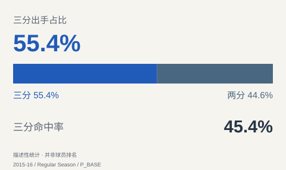

# 斯蒂芬·库里：把高难度投射变成高效率进攻

2015–16 常规赛研究｜金州勇士｜统计抓取于北京时间二〇二六年十月十七日。

本研究只评估全票 MVP 对应的常规赛。季后赛的对手、伤病和比赛结果需要另建样本，不能倒过来替代常规赛评价。

## 全票的意义：个人表现与球队成绩同时成立

库里的全票赛季是二〇一五至一六赛季。Marc Stein 当年的报道确认，他获得全部一百三十一张第一选票，勇士常规赛七十三胜九负；这是奖项与战绩背景，并不自动证明他在篮球每个方面都优于所有人。 [EXT_STEIN]

最值得强调的是高产与高效同时出现：库里出战79场，场均34.18分钟得到30.06分，真实命中率为66.9%，高出同季联盟整体12.82个百分点。真实命中率综合考虑两分、三分与罚球，这个差距比单看场均得分更能说明他的得分质量。 [P_BASE][T_BASE]

这组表现支持把他定位为以投射为主要武器的高负荷进攻核心。效率优势不是靠减少任务换来的，但这里比较的是联盟整体，没有消除位置、队友和出手机会难度的差异。 [P_ADV][P_BASE][T_BASE]

## 三分的价值：大量出手仍能保持准度

库里的三分出手达到886次，占全部投篮55.4%，命中率仍为45.4%；有效命中率达到63.0%。有效命中率把三分比两分多得的分计入，却不含罚球，因此它说明他的运动战投篮本身就很有效率。 [P_BASE]

Stein 的报道还指出，库里该季投进四百零二记三分，打破自己此前保持的单季纪录。报道把投射纪录与历史性战绩联系起来；本研究接受这些背景事实，但不把纪录数量直接换算成对手被牵制的回合数。 [EXT_STEIN]

他的进攻价值不能缩减为站定接球投篮。追踪表覆盖79场，场均持球急停出手8.80次、有效命中率60.8%；接球投篮场均5.20次、有效命中率68.2%。两种机会都能得分，让球队有理由在持球发起和接应终结之间切换他的任务。 [P_BASE][TR_PULL][TR_CATCH]

## 组织与无球：不必把每次进攻都握在手里

库里场均6.67次助攻、3.32次失误，助攻失误比2.01；追踪记录场均12.60次潜在助攻与8.00次突破。潜在助攻指传球后队友出手的机会记录，它提醒读者：实际助攻还受队友是否投进影响，但也不能把所有潜在助攻都当成他独立创造的空位。 [P_BASE][TR_PASS][TR_DRIVE]

全部运动战命中中，46.6%被记为受助攻，53.4%没有被记为受助攻；三分命中中受助攻比例为56.0%。这支持他既能利用队友传球终结、也能完成未记助攻进球的角色描述，不能据此把每个未受助攻命中都叫单打，或把受助攻比例叫接球投篮命中率。 [P_SCORE]

从这些记录出发，更合理的使用建议是让库里在持球进攻后继续参与接应，而非要求他承担所有传球发起。若另一名队友能在他交球后及时处理球，接球投射就能成为下一轮进攻的选择；能否进一步形成持续跑动牵制，仍要核验实际防守反应。 [P_SCORE][TR_CATCH][TR_PULL]

## 同角色比较：得分优势突出，助攻不是全部价值

按出场至少40场、总分钟至少1000、使用率至少25%、助攻率至少30%的统一规则，本次形成12人的高负荷组织核心样本。库里每75回合得到30.83分，组内中位数23.70分；真实命中率66.9%，组内中位数55.7%。同一回合尺度的比较更直接地支持他的得分优势。 [P_BASE][P_ADV][P_100][P_SCORE]

反向证据也应保留：库里每75回合助攻6.82次，低于组内中位数7.54次；助攻失误比2.01，也低于中位数2.18。非受助攻命中占比53.4%，低于中位数71.0%。因此，这个赛季不宜被描述为所有进攻都由他独自组织完成，更适合解释为得分主导、同时参与多人配合的核心。 [P_100][P_BASE][P_ADV][P_SCORE]

放宽角色门槛后样本为19人，收紧后为10人，库里的真实命中率统计百分位分别为97.37和95.00，得分百分位也分别为97.37和95.00。得分与效率的突出方向没有因门槛变化而消失；这些百分位描述本次样本位置，不是综合能力分。 [P_BASE][P_ADV][P_100][P_SCORE]

## 球队收益很大，不能全部算成个人因果贡献

真正的在场与不在场比较显示：库里在场时勇士每百回合得117.50分、失99.80分，净效率为17.70；不在场时得102.00分、失107.40分，净效率为−5.40。净效率差为23.10，进攻效率差为15.50，这说明两组阵容表现差异很大。 [P_ONOFF]

勇士的整体助攻率为68.0%，三分出手占比36.2%，每百回合得113.50分。这提供了传球与外线出手较多的球队背景，支持围绕库里的持球和接应安排多人分工；但球队整体数据不足以单独证明某一种具体战术造成了这些结果。 [T_ADV][T_BASE]

在场与不在场差值不能解释成库里个人每百回合净贡献，也不能把在场防守失分直接当作他的防守能力。库里场均2.14次抢断描述了夺回球权的事件，却没有回答他面对强壮持球者、换防或弱侧协防时的全部表现。 [P_ONOFF][P_BASE]

## 高阶模型：支持进攻判断，不能取代篮球解释

Basketball-Reference 的BPM为+11.9，其中进攻分量+10.3、防守分量+1.6；VORP为9.5。BPM使用技术统计和球队背景估计相对平均球员的每百回合表现，VORP再结合出勤与替补基准；二者与高效得分的方向一致，但并非两份相互独立的证明。 [EXT_IMPACT_BREF]

胜利贡献值WS为17.9，进攻份额13.8、防守份额4.1，WS/48为0.318。它们表示提供者按模型分配的赛季与单位时间胜利份额；进攻份额较大，与前面的表现相符，却不能说库里独自造成了对应数量的胜利。 [EXT_IMPACT_BREF]

数值百分位采用同值取中秩的方法，并以出场至少20场、总分钟至少500为门槛：NBA样本350人中，库里真实命中率百分位99.86；独立BR样本350人中，BPM百分位99.86。两张分布分别阅读，不比较雷达面积，也不把接近百分之百写成未经资格核验的联盟第一。 [P_BASE][P_ADV][EXT_IMPACT_BREF]

在NBA同口径350人样本中，库里的使用率数值百分位为99.14；使用率高位描述终结负荷，不等于综合能力更强。在场球队失分的数值百分位为11.14；在场球队失分的高值不是优势，且该指标不是个人防守评分。这里的低失分位置与球队阵容表现相符，仍不能隔离队友、对手和轮换的作用。 [P_BASE][P_ADV]

## 怎么使用这些结论，还需要补什么

综合来看，这一季最有说服力的优势是：承担较多得分任务时，库里仍保持很高效率，而且持球急停与接球投射都能参与进攻。合适的配置是能处理后续传球的队友、可靠的掩护和覆盖防守对位的阵容；代价是多人配合需要时机与球权协调，不能简单复制出手量就期待复制结果。 [P_BASE][P_ADV][TR_PULL][TR_CATCH]

本次未观看并登记比赛录像，所以不把“引力”写成已量化的个人贡献。下一步应逐回合记录对手在持球挡拆与交球后接应时是否增加防守人数，以及队友是否真正获得更好的出手；同时纳入失败和失误回合，避免只看精彩集锦。

数据覆盖与限制：逐次事件表保留了完整赛季1598次出手，出手、命中及三分总数与基础表一致。其中1596次有真实坐标，位置覆盖率为99.87%；另有2次同时缺少坐标和区域标签。位置图与交互筛选只使用1596次有坐标事件，缺失两次不补点；完整赛季区域图仍以1598次为分母，将区域标签缺失的2次单列。 [P_SHOT][P_BASE]

LEBRON转引的分钟范围不匹配，历史Actual EPM入口访问受限，均未采用。战术球评检索出现跨赛季文章，未将其观点套到本赛季；采用的署名原文仅为Stein的获奖报道。

本册的图表用于解释出手、效率、组织与球队背景；没有个人防守评分、综合实力分或未经核验的投篮热区。基础、追踪、On/Off与模型保留各自来源及定义，正文判断均可在结论清单中核对。
